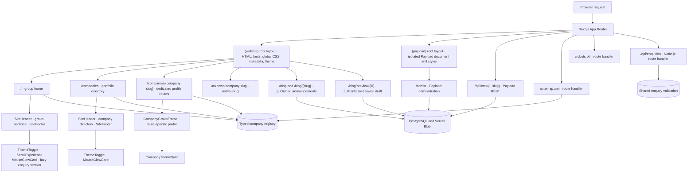
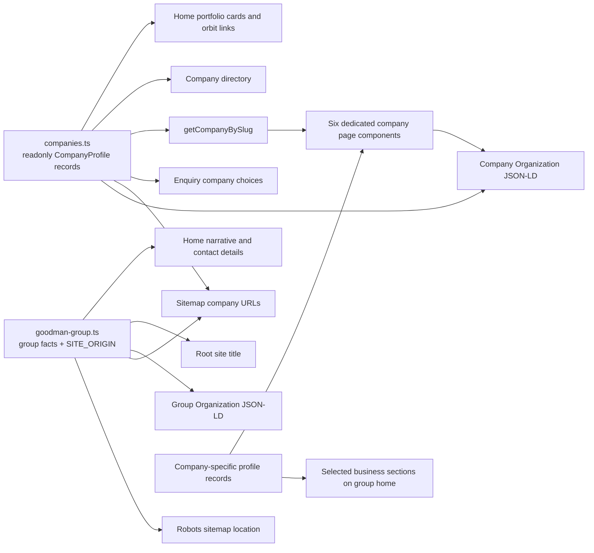
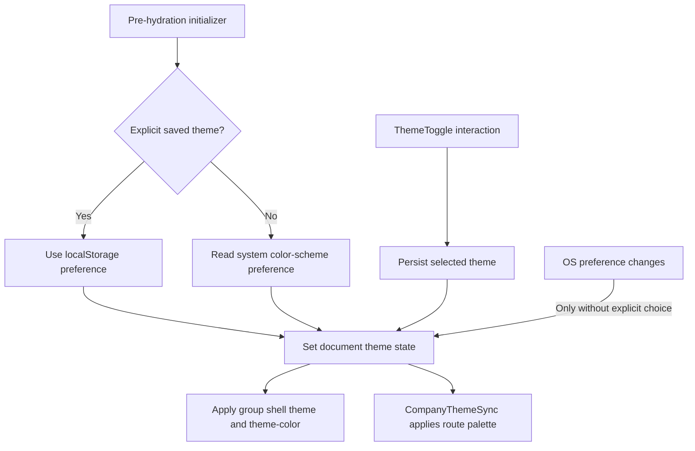
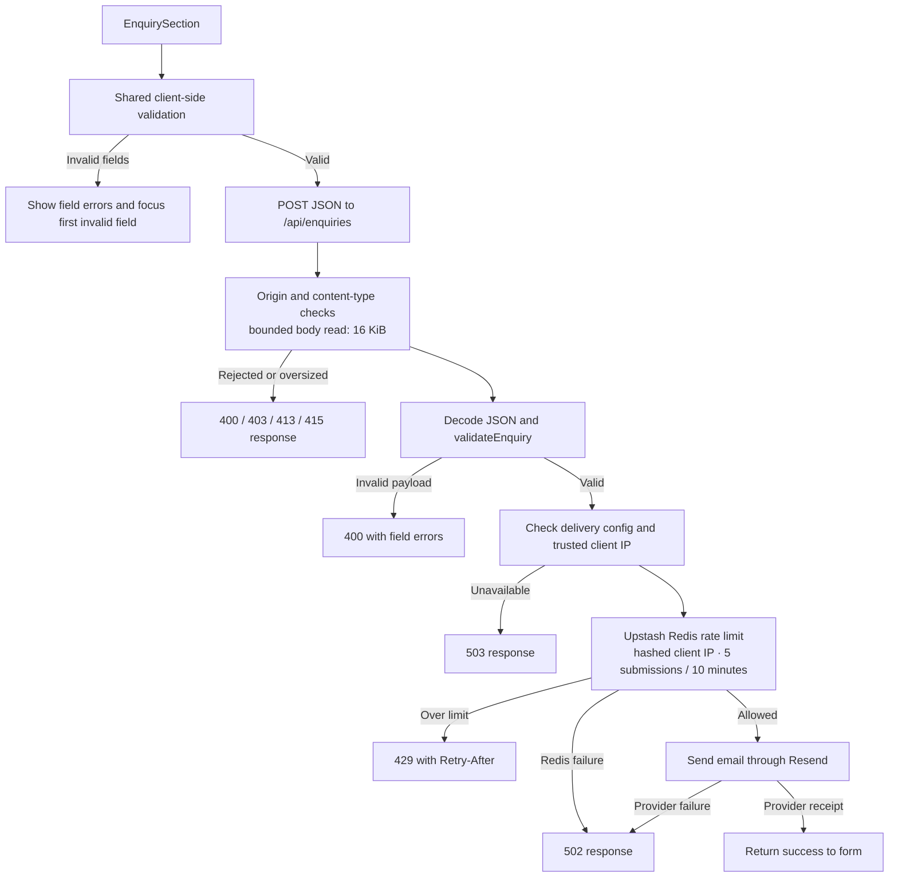

# Goodman Group — Corporate Portfolio

An architecture case study of a corporate portfolio and announcement Blog built with Next.js App Router, React, strict TypeScript, and embedded Payload CMS. The site connects a group-level story to a directory of six companies and six individually composed company profiles, while keeping content, metadata, and discovery endpoints aligned.

## Case study: one portfolio, distinct businesses

The engineering problem is a balance: the parent brand needs a coherent point of entry, but pharmaceutical businesses, a medical-equipment trader, a chemicals business, a medical-billing company, and a software-development company do not fit a single uniform profile layout. The site also needs stable company discovery, machine-readable organization metadata, a working enquiry channel, and interactive presentation without turning every route into a client-rendered application.

The implementation addresses that shape with three boundaries:

1. **A typed content boundary.** Company summaries and shared group facts live in TypeScript records. Pages and discovery surfaces consume those records directly; there is no content-fetching layer for portfolio data.
2. **A composition boundary.** The home page and directory are portfolio-specific compositions. Each company has its own route component and content layout; `CompanyGroupFrame` supplies shared group navigation and framing without forcing a generic profile template.
3. **An interaction boundary.** Route content is server-component-first. Browser state and effects live in focused client components for navigation, themes, pointer effects, scroll choreography, and enquiry submission.

### System architecture



`(website)/layout.tsx` establishes website document fonts, CSS, metadata defaults, and the pre-hydration theme initializer. Payload uses the separate `(payload)/layout.tsx` document, avoiding the website CSS and theme setup. Public portfolio and Blog routes use the website root; `/admin` uses the Payload root. Company routes share the group frame but retain separate page files and page-specific stylesheets. Unknown company slugs reach the explicit `notFound()` route rather than falling back to an invented profile.

Company profiles use a consistent dark-teal parent-brand masthead and footer with the Goodman Group logo, company identity and relationship, and directory navigation. The footer lists all companies from the canonical registry and identifies the current company with `aria-current="page"`. The shared chrome remains independent of company themes, stacks on mobile, and preserves skip navigation, visible keyboard focus, and reduced-motion preferences.

`MouseGlowCard` retains its last pointer coordinates on exit so the glow fades out in place rather than resetting to the card center.

Goodman Technologies demonstrates a layered CSS 3D software assembly with resolution-independent SVG surfaces, untransformed readable labels, keyboard/touch layer selection, and an assemble/separate control. Its route-local motion component lazily loads GSAP/ScrollTrigger for scroll-linked depth, staggered section entrances, and fine-pointer perspective. Live reduced-motion changes revert animation styles and listeners; server content and the static illustration remain available without JavaScript. It does not initialize another smooth-scroll instance.

The showcase inherits the shared Group theme: its panel, controls, SVG gradients, and diagram strokes use CSS `light-dark()` tokens. Light mode uses white/lavender/cyan surfaces with dark accents; dark mode retains navy surfaces. Theme changes do not remount the illustration or reset the selected layer.

The three primary service cards use server-rendered SVG scenes for responsive websites, mobile apps, and desktop software. Their vector surfaces share theme-aware colors, with short hover depth transitions limited to fine pointers and disabled under reduced motion.

The Technology section groups a 25-item inventory into languages/foundations, frameworks/runtimes, data/persistence, and tools/delivery. It uses a GSAP-pinned card stage with reading pauses, reversible scroll-driven transitions, and an active-layer rail. Pinning is enabled only on wide, sufficiently tall viewports when the measured content fits below the shared header. Enlarged text, reduced motion, forced colors, narrow/short viewports, and unavailable JavaScript retain all technology cards in normal document flow. Resize observers watch the card content rather than the pin spacer, and cleanup restores flow and removes the scroll triggers.

The pinned composition is vertically centered within the viewport area below the fixed header. Its scroll distance is based on card-stage height and the number of transitions, rather than a viewport-height multiplier, to avoid a prolonged empty tail.

Our approach uses a six-stage, keyboard-accessible tab navigator with bespoke server-rendered SVG scenes. Left/right arrows, Home, and End select stages; Tab moves into the selected panel. Panel transitions preserve full text contrast and stop under reduced motion. Without JavaScript, the navigator remains native section links and all six descriptions stay visible. Direct stage links open the matching panel.

Why Goodman uses a server-rendered commitment board: a dimensional code-handover illustration, direct communication and project-planning panels, and a 30-day support strip linking to the existing contact section. The support value and label are structured in the company profile. Only the SVG assembles on scroll; commitment text and the contact link remain fully opaque. Reduced motion retains the static illustration, and the board stacks naturally on smaller screens without pinning or hidden content.

The director section presents Haris Khan through an Expertise Orbit: a locally hosted portrait, four server-rendered expertise cards, and theme-aware orbital arcs. Its heading and subheading are centered across the full orbit width. The profile and links live in the typed Technologies record. A small client boundary adds fine-pointer portrait parallax and a brief orbital-node entrance when the section comes into view. Live reduced-motion changes disable animation and pointer transforms. Narrow layouts and enlarged text move the portrait above an intrinsic card grid, and the complete profile remains available without JavaScript.

The homepage loads the interactive enquiry form as its contact section approaches the viewport. The initial contact section retains an email link without JavaScript, and keyboard users can open the form explicitly; failed loads offer a retry.

### Portfolio content model and data flow

`src/data/companies.ts` is the portfolio index. Its readonly, typed records hold the shared identity and directory-level facts—slug, name, business, summary, logo, locations, leadership, capabilities, and contact details—and `getCompanyBySlug` provides the route lookup. `src/data/goodman-group.ts` holds group-level facts and the canonical site origin. More detailed records live in company-specific modules under `src/data/` where needed; each route decides how to present those details.

The Group and Goodman Billing US contact address is **91 Ferry Street, Apt 3, Jersey City, New Jersey 07307-0730, United States**. The shared footer and Billing contact section link to [Google Maps](https://maps.app.goo.gl/bcR9n6BEF7GsEq5V6); organization JSON-LD uses the same Jersey City address.



This company registry keeps the portfolio home, directory, profile lookup, enquiry choices, company URLs, and company structured data aligned. The sitemap also includes published Blog URLs from Payload. Group facts remain separate from company facts; detailed page modules express company-specific content without bloating the directory contract or requiring irrelevant fields.

### Route composition and reuse

| Route surface | Composition | Architectural role |
|---|---|---|
| `/` | Group landing page, portfolio sections, leadership/history, and enquiry section | Narrative entry point and portfolio overview |
| `/companies` | Directory rendered from the company registry | Direct browse-and-select surface |
| `/companies/goodman-laboratories` | Dedicated profile route | Manufacturing and distribution profile |
| `/companies/geron-pharma` | Dedicated profile route | Pharmaceutical business profile |
| `/companies/goodman-medical-equipment` | Dedicated profile route | Medical-equipment trading profile |
| `/companies/wal-green-chemicals` | Dedicated profile route | Chemicals and raw-materials profile |
| `/companies/goodman-billing` | Dedicated profile route, including a billing directory | Medical-billing profile and its supporting content |
| `/companies/goodman-technologies` | Software studio with interactive architecture and progressive motion | Software-development profile |
| `/blog`, `/blog/[slug]` | Request-time published announcement listing and article | Public, server-rendered Blog |
| `/blog/preview/[id]` | Authenticated saved-draft preview | Private, uncached editorial preview |
| `/admin` | Payload admin under its separate root layout | Authenticated CMS administration |
| `/api/cms/[...slug]` | Payload REST/auth/media handlers | CMS API, isolated from the existing enquiry route |
| `/sitemap.xml`, `/robots.txt` | Route handlers | Search discovery from the site origin, portfolio registry, and published Blog |
| `/api/enquiries` | Node.js route handler | Validates, rate-limits, and delivers submitted enquiries |

The shared frame is intentionally narrow: it contributes group navigation, the skip link, the main-content target, footer links, and company-theme synchronization. It does not own the company page body. Each profile route controls its own sections, metadata, and visual language; company-prefixed stylesheets keep those differences local.

## Interactive systems

The page tree stays server-component-first. Client components are used where the browser owns changing state or effects. The homepage imports its enquiry section through `next/dynamic`, splitting that component from the static imports in the page module. The homepage scroll controller lazily imports Lenis, GSAP, and ScrollTrigger, observes reduced-motion preference, and manages setup and cleanup with the React effect lifecycle.

### Theme lifecycle



The initial theme is applied before the page becomes interactive to reduce theme flash. The group shell uses its own light/dark chrome colors; each bespoke company shell maps the shared theme choice to its own palette and browser `theme-color`. The theme toggle, initializer, and company synchronization share the root theme attribute rather than introducing a global state store.

### Enquiry delivery path



The company and enquiry-type choices are derived from typed options, and the same `validateEnquiry` contract runs in the browser and route handler. The server re-checks all data, caps request-body memory, rejects a non-empty honeypot, applies a Redis-backed per-IP limit, and returns success only after the email provider returns a receipt. Missing service configuration, untrusted or invalid client-IP context, and provider failures remain explicit error paths rather than false successes.

## Metadata, discovery, and delivery

- Root and route-level metadata use Next.js metadata exports; company pages set their own titles and canonical paths.
- `OrganizationJsonLd` emits group-level or company-level JSON-LD from the same group and company records used to render pages.
- The sitemap composes the home, directory, company URLs, and published Blog URLs from `SITE_ORIGIN`, the registry, and the CMS. The robots route points crawlers to that sitemap.
- `next.config.ts` enables standalone output, compression, the React Compiler, and AVIF/WebP image formats. Production packaging includes the public assets and Next static assets with the standalone server output.

## Quality model

The quality model follows both application boundaries: portfolio data/component/route tests cover registry, company pages, themes, discovery, and enquiry behavior; CMS tests cover lifecycle, media, mutation serialization, and environment rules. Browser journeys cover portfolio pages and Blog/admin workflows on desktop and selected mobile layouts.

## Repository map

| Area | Responsibility |
|---|---|
| `src/app/(website)/` | Portfolio and Blog routes under the website document, global styles, and company-specific styles |
| `src/app/(payload)/` | Isolated Payload admin document and CMS API route handlers |
| `src/components/` | Shared navigation, company framing/cards, themes, scroll behavior, and enquiry UI |
| `src/data/` | Group facts, company registry, detailed company records, and enquiry contract |
| `src/cms/` | Payload collections, environment/mutation helpers, administration tools, and CMS unit tests |
| `src/lib/blog/` | Server-only Blog queries, rendering, and metadata |
| `src/migrations/`, `payload.config.ts` | Payload schema migrations and the shared CMS configuration |
| `scripts/` | Administrative, backup, restore, and operations-packaging commands |
| `public/assets/` | Logos and site media |
| `tests/cms/`, `tests/e2e/` | CMS integration fixtures and browser-level user journeys |

## Payload Blog operations

The public Blog is backed by Payload, PostgreSQL and Vercel Blob. Public articles come from published records; draft preview and administration require an administrator session. Uploaded images are public even when associated with a draft.

### Configuration

Use Node 24 (`>=24.22.1 <25`) and npm 11.17.0. Supply the following to the Vercel build and runtime and to the Payload CLI through a protected environment file:

| Variable | Purpose |
|---|---|
| `DATABASE_URL` | PostgreSQL connection URL for the deployment's database |
| `BLOB_READ_WRITE_TOKEN` | Read/write token for that deployment's public Vercel Blob store |
| `PAYLOAD_SECRET` | Stable, high-entropy secret of at least 32 characters |
| `PAYLOAD_CONFIG_PATH` | Absolute path to `payload.config.ts` for standalone Payload CLI commands |

Use separate databases, Blob stores and secrets for production, previews and tests. Do not commit credentials. Production trusts the configured site origin; a Vercel preview additionally trusts its validated `VERCEL_URL`. Preview URLs do not change the canonical site origin.

Remote PostgreSQL connections use TLS with certificate and hostname verification in both Payload and the CMS mutation gate. The bundled Supabase 2021 root CA is used for Supabase endpoints; update it when Supabase rotates its root. Loopback databases may use plaintext for local testing. URL TLS options that disable verification are rejected.

The enquiry API separately requires `RESEND_API_KEY`, `ENQUIRY_FROM_EMAIL`, `ENQUIRY_TO_EMAIL`, `UPSTASH_REDIS_REST_URL`, and `UPSTASH_REDIS_REST_TOKEN`.

CMS integration tests require Docker, a disposable PostgreSQL container, and the Payload Blob emulator. Rendering and production-mode browser checks additionally require a separate real test Blob store configured via `CMS_TEST_REAL_BLOB_READ_WRITE_TOKEN` and `CMS_TEST_REAL_BLOB_STORE_ID`; CI obtains those from its dedicated test-store secret and variable. Never use a production store for tests. The emulator does not verify real Blob authorization.

### Initial database and administrator

The PostgreSQL migration creates an empty schema; it does not import an existing SQLite database or local uploads. Preserve any old database and files until a separately verified migration is complete. Do not deploy over existing content expecting this migration to transfer it.

Before executing Payload CLI commands, clear inherited CMS variables that could override the protected environment file. Run the matching release's CLI with the intended database and Blob credentials. Keep production traffic and other writers stopped during schema migrations and initial administrator creation:

```sh
node --env-file=/absolute/private/cms.env ./node_modules/payload/bin.js migrate
node --env-file=/absolute/private/cms.env ./node_modules/payload/bin.js run scripts/cms-create-admin.ts
```

The administrator command prompts for credentials; do not include passwords in shell commands or environment variables. Password recovery uses `scripts/cms-reset-password.ts` through the same Payload CLI and protected configuration.

### Mutation coordination and recovery

All CMS writers must use the shared PostgreSQL mutation gate against the same primary database. A crashed operation can leave the `cms_mutation_lock` row behind. If operations time out waiting for the lock, confirm the owner and all its work have completely stopped before an authorized operator deletes the row. Never clear a live lock:

```sql
DELETE FROM cms_mutation_lock WHERE id = 1;
```

### Backup and upload limitations

The previous SQLite/local-file backup and restore scripts do not back up PostgreSQL or Blob. Before storing real content, establish and rehearse a coordinated database-and-object backup and restore process, including writer quiescence, encrypted off-host retention, and restoration into isolated resources. Database backups alone do not preserve uploaded images. Keep the matching application release and schema with each recovery point.

Vercel Functions impose a request-body limit. Images are limited to 4,000,000 bytes so multipart requests can fit within that limit while retaining server-side validation and metadata removal. Do not bypass image validation using direct client uploads.

### Editing

Administrators use `/admin` to save drafts, upload images with meaningful alt text, preview saved drafts, and publish or unpublish announcements. The first publication date and slug remain fixed. Restoring a version saves it as a draft, not a publication. Payload retains at most 20 versions per announcement; revision history is not a backup.

