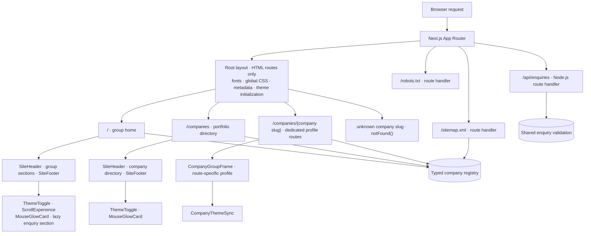
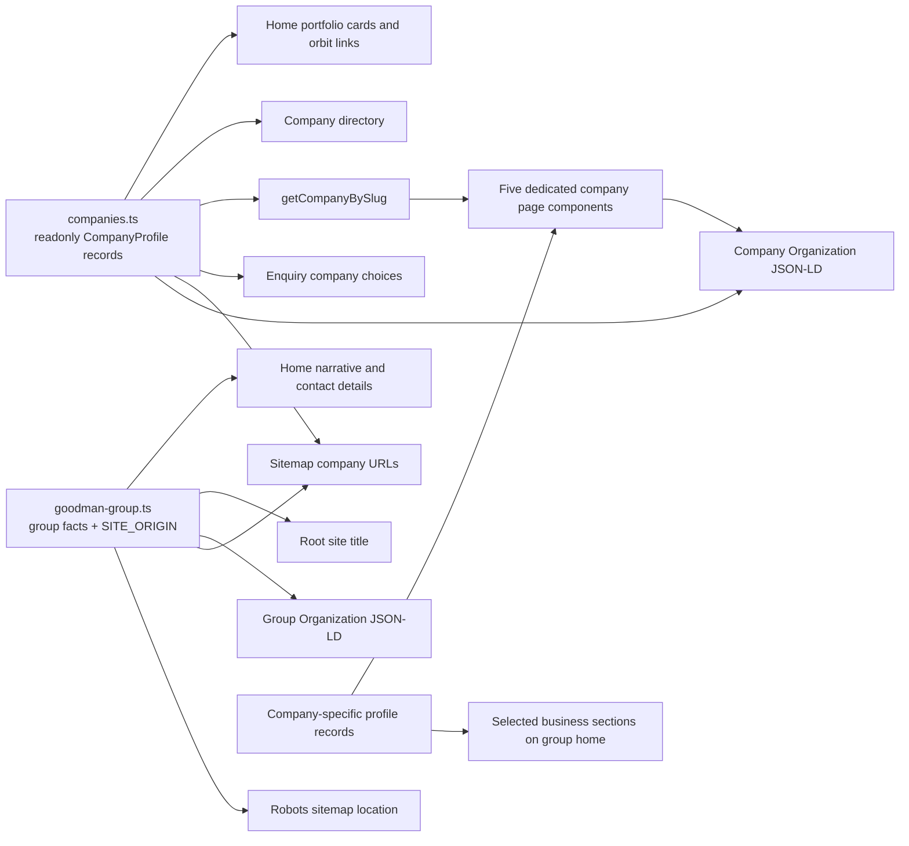
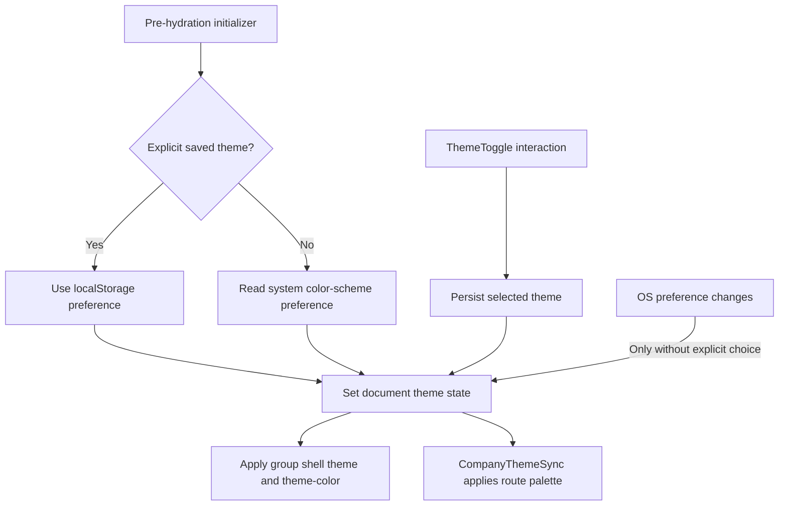
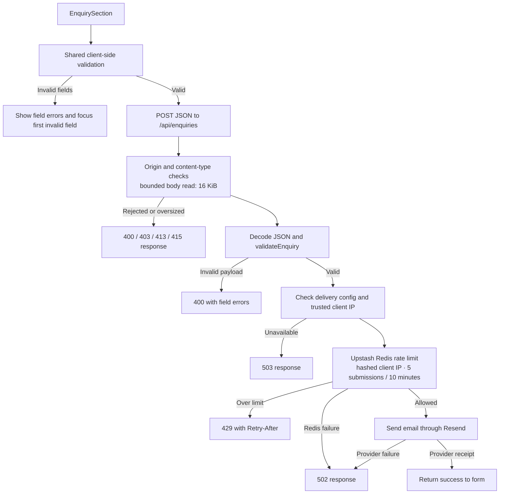

# Goodman Group — Corporate Portfolio

An architecture case study of a portfolio website built with Next.js App Router, React, and strict TypeScript. The site connects a group-level story to a directory of five companies and five individually composed company profiles, while keeping content, metadata, and discovery endpoints aligned.

## Case study: one portfolio, distinct businesses

The engineering problem is a balance: the parent brand needs a coherent point of entry, but a pharmaceutical manufacturer, a medical-equipment trader, a chemicals business, a medical-billing company, and a pharmaceutical business do not fit a single uniform profile layout. The site also needs stable company discovery, machine-readable organization metadata, a working enquiry channel, and interactive presentation without turning every route into a client-rendered application.

The implementation addresses that shape with three boundaries:

1. **A typed content boundary.** Company summaries and shared group facts live in TypeScript records. Pages and discovery surfaces consume those records directly; there is no content-fetching layer for portfolio data.
2. **A composition boundary.** The home page and directory are portfolio-specific compositions. Each company has its own route component and content layout; `CompanyGroupFrame` supplies shared group navigation and framing without forcing a generic profile template.
3. **An interaction boundary.** Route content is server-component-first. Browser state and effects live in focused client components for navigation, themes, pointer effects, scroll choreography, and enquiry submission.

### System architecture

`RootLayout` establishes document-wide fonts, CSS, metadata defaults, and a pre-hydration theme initializer; route components own their page composition. The company routes share the group frame but retain separate page files and page-specific stylesheets. Unknown slugs reach the explicit `notFound()` route rather than falling back to an invented profile.

### Content model and data flow

`src/data/companies.ts` is the portfolio index. Its readonly, typed records hold the shared identity and directory-level facts—slug, name, business, summary, logo, locations, leadership, capabilities, and contact details—and `getCompanyBySlug` provides the route lookup. `src/data/goodman-group.ts` holds group-level facts and the canonical site origin. More detailed records live in company-specific modules under `src/data/` where needed; each route decides how to present those details.

This single registry keeps the home page, directory, profile lookup, enquiry selector, sitemap, and company structured data in agreement. Group facts remain separate from company facts. The detailed page modules can express company-specific content without bloating the directory contract or requiring fields irrelevant to every company.

### Route composition and reuse

| Route surface | Composition | Architectural role |
|---|---|---|
| `/` | Group landing page, portfolio sections, leadership/history, and enquiry section | Narrative entry point and portfolio overview |
| `/companies` | Directory rendered from the company registry | Direct browse-and-select surface |
| `/companies/goodman-laboratories` | Dedicated profile route | Manufacturing and distribution profile |
| `/companies/geron-pharma` | Dedicated profile route | Pharmaceutical business profile |
| `/companies/goodman-medical-equipment` | Dedicated profile route | Medical-equipment trading profile |
| `/companies/wal-green-chemicals` | Dedicated profile route | Chemicals and raw-materials profile |
| `/companies/goodman-billing` | Dedicated profile route, including a billing directory | Medical-billing profile and its supporting content |
| `/sitemap.xml`, `/robots.txt` | Route handlers | Search discovery generated from the same site origin and company registry |
| `/api/enquiries` | Node.js route handler | Validates, rate-limits, and delivers submitted enquiries |

The shared frame is intentionally narrow: it contributes group navigation, the skip link, the main-content target, footer links, and company-theme synchronization. It does not own the company page body. Each profile route controls its own sections, metadata, and visual language; company-prefixed stylesheets keep those differences local.

## Interactive systems

The page tree stays server-component-first. Client components are used where the browser owns changing state or effects. The homepage imports its enquiry section through `next/dynamic`, splitting that component from the static imports in the page module. The homepage scroll controller lazily imports Lenis, GSAP, and ScrollTrigger, observes reduced-motion preference, and manages setup and cleanup with the React effect lifecycle.

### Theme lifecycle

The initial theme is applied before the page becomes interactive to reduce theme flash. The group shell uses its own light/dark chrome colors; each bespoke company shell maps the shared theme choice to its own palette and browser `theme-color`. The theme toggle, initializer, and company synchronization share the root theme attribute rather than introducing a global state store.

### Enquiry delivery path

The company and enquiry-type choices are derived from typed options, and the same `validateEnquiry` contract runs in the browser and route handler. The server re-checks all data, caps request-body memory, rejects a non-empty honeypot, applies a Redis-backed per-IP limit, and returns success only after the email provider returns a receipt. Missing service configuration, untrusted or invalid client-IP context, and provider failures remain explicit error paths rather than false successes.

## Metadata, discovery, and delivery

- Root and route-level metadata use Next.js metadata exports; company pages set their own titles and canonical paths.
- `OrganizationJsonLd` emits group-level or company-level JSON-LD from the same group and company records used to render pages.
- The sitemap composes the home, directory, and company URLs from `SITE_ORIGIN` and the registry. The robots route points crawlers to that sitemap.
- `next.config.ts` enables standalone output, compression, the React Compiler, and AVIF/WebP image formats. Production packaging includes the public assets and Next static assets with the standalone server output.

## Quality model

The checks follow the boundaries in the application: data-invariant tests cover registry and profile contracts; component tests exercise navigation, themes, company framing, and enquiry behavior; route tests cover discovery and server-side enquiry validation; Playwright browser journeys cover the homepage, company routes, themes, enquiry flow, and unknown routes, with desktop Chrome and selected mobile-Chrome journeys. Coverage configuration enforces 80% thresholds for branches, functions, lines, and statements, with app system files and the frame-sensitive scroll controller excluded from that measurement.

## Repository map

| Area | Responsibility |
|---|---|
| `src/app/` | App Router pages, route handlers, global styles, and company-specific page styles |
| `src/components/` | Shared navigation, company framing/cards, themes, scroll behavior, and enquiry UI |
| `src/data/` | Group facts, company registry, detailed company records, and enquiry contract |
| `src/lib/` | Theme helpers and structured-data generation |
| `public/assets/` | Logos and site media |
| `tests/e2e/` | Browser-level user journeys |
