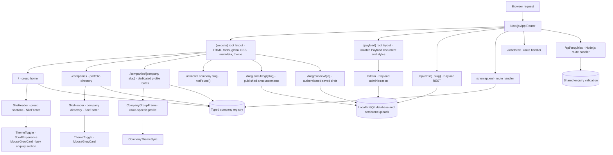
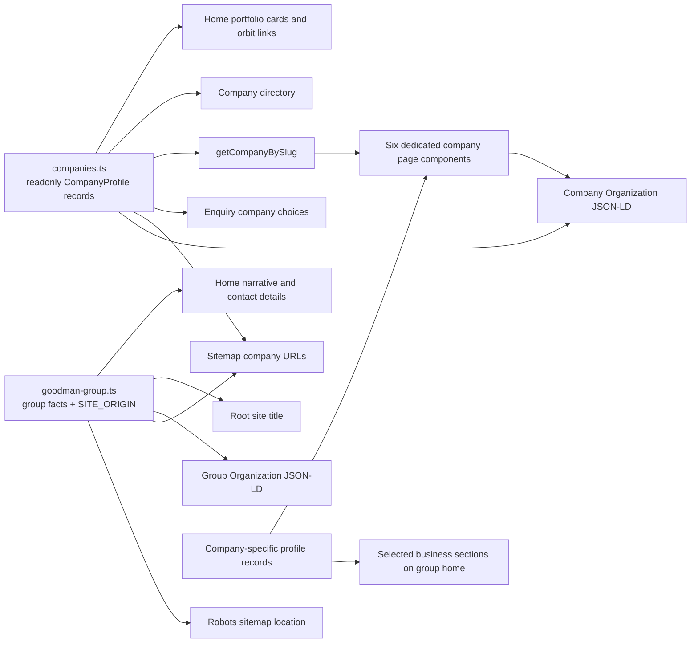
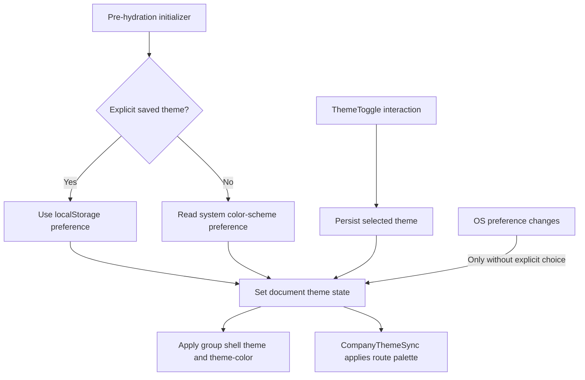
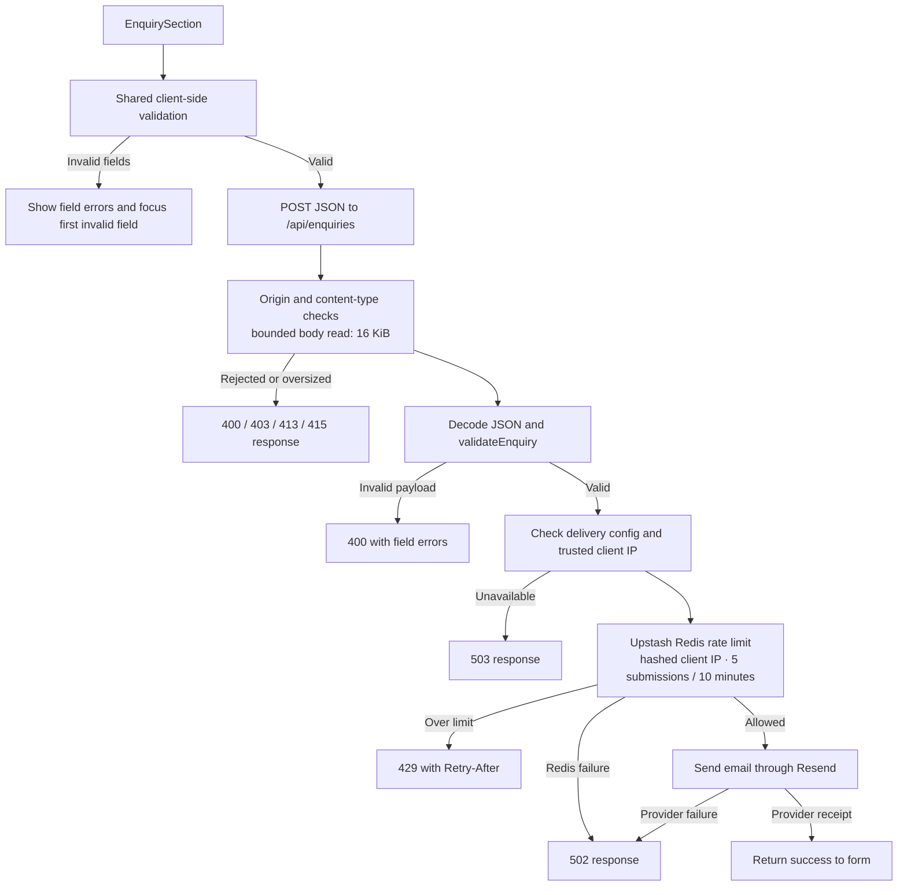

# Goodman Group — Corporate Portfolio

An architecture case study of a corporate portfolio and announcement Blog built with Next.js App Router, React, strict TypeScript, and embedded Payload CMS. The site connects a group-level story to a directory of six companies and six individually composed company profiles, while keeping content, metadata, and discovery endpoints aligned.

## Case study: one portfolio, distinct businesses

The engineering problem is a balance: the parent brand needs a coherent point of entry, but pharmaceutical businesses, a medical-equipment trader, a chemicals business, a medical-billing company, and a software-development company do not fit a single uniform profile layout. The site also needs stable company discovery, machine-readable organization metadata, a working enquiry channel, and interactive presentation without turning every route into a client-rendered application.

The implementation addresses that shape with three boundaries:

1. **A typed content boundary.** Company summaries and shared group facts live in TypeScript records. Pages and discovery surfaces consume those records directly; there is no content-fetching layer for portfolio data.
2. **A composition boundary.** The home page and directory are portfolio-specific compositions. Each company has its own route component and content layout; `CompanyGroupFrame` supplies shared group navigation and framing without forcing a generic profile template.
3. **An interaction boundary.** Route content is server-component-first. Browser state and effects live in focused client components for navigation, themes, pointer effects, scroll choreography, and enquiry submission.

### System architecture



`(website)/layout.tsx` establishes website document fonts, CSS, metadata defaults, and the pre-hydration theme initializer. Payload uses the separate `(payload)/layout.tsx` document, avoiding the website CSS and theme setup. Public portfolio and Blog routes use the website root; `/admin` uses the Payload root. Company routes share the group frame but retain separate page files and page-specific stylesheets. Unknown company slugs reach the explicit `notFound()` route rather than falling back to an invented profile.

Company profiles use a consistent dark-teal parent-brand masthead and footer with the Goodman Group logo, company identity and relationship, and directory navigation. The footer lists all companies from the canonical registry and identifies the current company with `aria-current="page"`. The shared chrome remains independent of company themes, stacks on mobile, and preserves skip navigation, visible keyboard focus, and reduced-motion preferences.

`MouseGlowCard` retains its last pointer coordinates on exit so the glow fades out in place rather than resetting to the card center.

Goodman Technologies demonstrates a layered CSS 3D software assembly with resolution-independent SVG surfaces, untransformed readable labels, keyboard/touch layer selection, and an assemble/separate control. Its route-local motion component lazily loads GSAP/ScrollTrigger for scroll-linked depth, staggered section entrances, and fine-pointer perspective. Live reduced-motion changes revert animation styles and listeners; server content and the static illustration remain available without JavaScript. It does not initialize another smooth-scroll instance.

The showcase inherits the shared Group theme: its panel, controls, SVG gradients, and diagram strokes use CSS `light-dark()` tokens. Light mode uses white/lavender/cyan surfaces with dark accents; dark mode retains navy surfaces. Theme changes do not remount the illustration or reset the selected layer.

The three primary service cards use server-rendered SVG scenes for responsive websites, mobile apps, and desktop software. Their vector surfaces share theme-aware colors, with short hover depth transitions limited to fine pointers and disabled under reduced motion.

The Technology section groups a 25-item inventory into languages/foundations, frameworks/runtimes, data/persistence, and tools/delivery. It uses a GSAP-pinned card stage with reading pauses, reversible scroll-driven transitions, and an active-layer rail. Pinning is enabled only on wide, sufficiently tall viewports when the measured content fits below the shared header. Enlarged text, reduced motion, forced colors, narrow/short viewports, and unavailable JavaScript retain all technology cards in normal document flow. Resize observers watch the card content rather than the pin spacer, and cleanup restores flow and removes the scroll triggers.

The pinned composition is vertically centered within the viewport area below the fixed header. Its scroll distance is based on card-stage height and the number of transitions, rather than a viewport-height multiplier, to avoid a prolonged empty tail.

Our approach uses a six-stage, keyboard-accessible tab navigator with bespoke server-rendered SVG scenes. Left/right arrows, Home, and End select stages; Tab moves into the selected panel. Panel transitions preserve full text contrast and stop under reduced motion. Without JavaScript, the navigator remains native section links and all six descriptions stay visible. Direct stage links open the matching panel.

Why Goodman uses a server-rendered commitment board: a dimensional code-handover illustration, direct communication and project-planning panels, and a 30-day support strip linking to the existing contact section. The support value and label are structured in the company profile. Only the SVG assembles on scroll; commitment text and the contact link remain fully opaque. Reduced motion retains the static illustration, and the board stacks naturally on smaller screens without pinning or hidden content.

The homepage loads the interactive enquiry form as its contact section approaches the viewport. The initial contact section retains an email link without JavaScript, and keyboard users can open the form explicitly; failed loads offer a retry.

### Portfolio content model and data flow

`src/data/companies.ts` is the portfolio index. Its readonly, typed records hold the shared identity and directory-level facts—slug, name, business, summary, logo, locations, leadership, capabilities, and contact details—and `getCompanyBySlug` provides the route lookup. `src/data/goodman-group.ts` holds group-level facts and the canonical site origin. More detailed records live in company-specific modules under `src/data/` where needed; each route decides how to present those details.

The Group and Goodman Billing US contact address is **91 Ferry Street, Apt 3, Jersey City, New Jersey 07307-0730, United States**. The shared footer and Billing contact section link to [Google Maps](https://maps.app.goo.gl/bcR9n6BEF7GsEq5V6); organization JSON-LD uses the same Jersey City address.



This company registry keeps the portfolio home, directory, profile lookup, enquiry choices, company URLs, and company structured data aligned. The sitemap also includes published Blog URLs from Payload. Group facts remain separate from company facts; detailed page modules express company-specific content without bloating the directory contract or requiring irrelevant fields.

### Route composition and reuse

| Route surface | Composition | Architectural role |
|---|---|---|
| `/` | Group landing page, portfolio sections, leadership/history, and enquiry section | Narrative entry point and portfolio overview |
| `/companies` | Directory rendered from the company registry | Direct browse-and-select surface |
| `/companies/goodman-laboratories` | Dedicated profile route | Manufacturing and distribution profile |
| `/companies/geron-pharma` | Dedicated profile route | Pharmaceutical business profile |
| `/companies/goodman-medical-equipment` | Dedicated profile route | Medical-equipment trading profile |
| `/companies/wal-green-chemicals` | Dedicated profile route | Chemicals and raw-materials profile |
| `/companies/goodman-billing` | Dedicated profile route, including a billing directory | Medical-billing profile and its supporting content |
| `/companies/goodman-technologies` | Software studio with interactive architecture and progressive motion | Software-development profile |
| `/blog`, `/blog/[slug]` | Request-time published announcement listing and article | Public, server-rendered Blog |
| `/blog/preview/[id]` | Authenticated saved-draft preview | Private, uncached editorial preview |
| `/admin` | Payload admin under its separate root layout | Authenticated CMS administration |
| `/api/cms/[...slug]` | Payload REST/auth/media handlers | CMS API, isolated from the existing enquiry route |
| `/sitemap.xml`, `/robots.txt` | Route handlers | Search discovery from the site origin, portfolio registry, and published Blog |
| `/api/enquiries` | Node.js route handler | Validates, rate-limits, and delivers submitted enquiries |

The shared frame is intentionally narrow: it contributes group navigation, the skip link, the main-content target, footer links, and company-theme synchronization. It does not own the company page body. Each profile route controls its own sections, metadata, and visual language; company-prefixed stylesheets keep those differences local.

## Interactive systems

The page tree stays server-component-first. Client components are used where the browser owns changing state or effects. The homepage imports its enquiry section through `next/dynamic`, splitting that component from the static imports in the page module. The homepage scroll controller lazily imports Lenis, GSAP, and ScrollTrigger, observes reduced-motion preference, and manages setup and cleanup with the React effect lifecycle.

### Theme lifecycle



The initial theme is applied before the page becomes interactive to reduce theme flash. The group shell uses its own light/dark chrome colors; each bespoke company shell maps the shared theme choice to its own palette and browser `theme-color`. The theme toggle, initializer, and company synchronization share the root theme attribute rather than introducing a global state store.

### Enquiry delivery path



The company and enquiry-type choices are derived from typed options, and the same `validateEnquiry` contract runs in the browser and route handler. The server re-checks all data, caps request-body memory, rejects a non-empty honeypot, applies a Redis-backed per-IP limit, and returns success only after the email provider returns a receipt. Missing service configuration, untrusted or invalid client-IP context, and provider failures remain explicit error paths rather than false successes.

## Metadata, discovery, and delivery

- Root and route-level metadata use Next.js metadata exports; company pages set their own titles and canonical paths.
- `OrganizationJsonLd` emits group-level or company-level JSON-LD from the same group and company records used to render pages.
- The sitemap composes the home, directory, company URLs, and published Blog URLs from `SITE_ORIGIN`, the registry, and the CMS. The robots route points crawlers to that sitemap.
- `next.config.ts` enables standalone output, compression, the React Compiler, and AVIF/WebP image formats. Production packaging includes the public assets and Next static assets with the standalone server output.

## Quality model

The quality model follows both application boundaries: portfolio data/component/route tests cover registry, company pages, themes, discovery, and enquiry behavior; CMS unit and real-SQLite integration tests cover lifecycle, media, mutation serialization, and environment rules. Browser journeys cover portfolio pages and Blog/admin workflows on desktop and selected mobile layouts. Coverage configuration enforces its configured thresholds; checks must be recorded with their actual results rather than inferred from a passing build.

## Repository map

| Area | Responsibility |
|---|---|
| `src/app/(website)/` | Portfolio and Blog routes under the website document, global styles, and company-specific styles |
| `src/app/(payload)/` | Isolated Payload admin document and CMS API route handlers |
| `src/components/` | Shared navigation, company framing/cards, themes, scroll behavior, and enquiry UI |
| `src/data/` | Group facts, company registry, detailed company records, and enquiry contract |
| `src/cms/` | Payload collections, environment/mutation helpers, administration tools, and CMS unit tests |
| `src/lib/blog/` | Server-only Blog queries, rendering, and metadata |
| `src/migrations/`, `payload.config.ts` | Payload schema migrations and the shared CMS configuration |
| `scripts/` | Administrative, backup, restore, and operations-packaging commands |
| `public/assets/` | Logos and site media |
| `tests/cms/`, `tests/e2e/` | CMS integration fixtures and browser-level user journeys |

## Payload Blog operations

The public Blog is backed by Payload in this Next.js application. The CMS uses one local SQLite-compatible libSQL database and local uploads; it does not use a managed database, cloud object storage, a CMS email service, or a background worker. Public articles are rendered from published records. Draft preview and administration require the administrator session. Uploaded images are public by design, including when an article is still a draft; database files, backups, manifests, and secrets must remain outside the web root.

Public articles, including slugs beginning with `preview-`, and image downloads under `/api/cms/media/file/` are crawlable. Other CMS API routes, administration, and saved-draft previews remain excluded from search indexing. Responsive Blog images include the original upload alongside generated sizes for high-density displays; listing cards without cover images use the full card width.

### Local development: first CMS setup

`npm run dev` does not generate CMS configuration or initialize the database. Next loads `.env.local`, not `.env.example`; the Payload CLI must be given the same file explicitly.

1. Before starting the dev server, copy `.env.example` to `.env.local` if no local environment file exists. Preserve existing enquiry settings. Replace every placeholder: use absolute database/uploads paths outside this checkout (for example, beneath your home directory's `.local/share/goodman-group-dev`), and set `PAYLOAD_CONFIG_PATH` to this checkout's absolute `payload.config.ts` path.
2. Create the database parent directory and uploads directory. Generate a stable development secret with `node -p "require('node:crypto').randomBytes(32).toString('hex')"` and put it in `PAYLOAD_SECRET`. Keep `.env.local` uncommitted and restrict it to the local user (`chmod 600 .env.local`). Do not reuse this development secret in production.
3. With the dev server stopped, initialize the schema and optionally create the sole local administrator:

```sh
node --env-file=.env.local ./node_modules/payload/bin.js migrate
node --env-file=.env.local ./node_modules/payload/bin.js run scripts/cms-create-admin.ts
npm run dev
```

Administrator creation prompts for credentials; do not put passwords in commands or environment files. It is only needed for editing, not public Blog reading. Restart the dev server after changing environment settings. Keep the database and secret stable between restarts; do not use `CMS_TEST_ROOT` for ordinary development. Clear any conflicting inherited CMS environment variables first: Node's `--env-file` does not override exported shell values.

### Runtime and private data setup

Use the supported Node 24 runtime (`>=24.22.1 <25`) and repository-pinned npm (`npm@11.17.0`). Configure the one Node application with:

| Environment setting or application configuration | Required value |
|---|---|
| `DATABASE_URL` | An absolute local file URL such as `file:/ABSOLUTE_PRIVATE_PATH/shared/data/blog.sqlite` |
| `UPLOAD_DIR` | An absolute persistent directory such as `/ABSOLUTE_PRIVATE_PATH/shared/uploads` |
| `PAYLOAD_SECRET` | A stable secret of at least 32 characters, stored only in protected host configuration |
| Canonical origin (`SITE_ORIGIN`) | The existing Group configuration's canonical production origin, `https://goodmangoc.com`; never derive it from an incoming Host header |
| `NODE_ENV` | `production` for the deployed application and maintenance commands |
| `PAYLOAD_CONFIG_PATH` | The absolute path to the matching release's `payload.config.ts` |

All production paths above are symbolic examples, not paths observed on the hosting account. Database, SQLite sidecars, uploads, backups, and secrets must be private, persistent as applicable, outside `public/`, `.next/`, and replaceable releases. Keep free disk capacity for the live data, generated image sizes, backups, and a previous release. Do not run clustered workers or a second application instance against this local database.

For isolated tests only, `CMS_TEST_ROOT` may name an absolute directory beneath the operating system's temporary directory, separate from the release being exercised. Set `DATABASE_URL` to the absolute `file:` URL for exactly `<CMS_TEST_ROOT>/blog.sqlite` and `UPLOAD_DIR` to exactly `<CMS_TEST_ROOT>/uploads`. This enables `SITE_ORIGIN` plus localhost/127.0.0.1 origins on ports 3000 and 4173, including when exercising the standalone artifact with `NODE_ENV=production`. It does not make those paths suitable for deployment. Never set `CMS_TEST_ROOT` on a deployed host; keep test data isolated and temporary.

### Operations package and first setup

After generating migrations, Payload types, and the admin import map and completing the release checks, run `npm run package:operations` in the release-build environment. Packaging stages the unchanged `package.json`, `package-lock.json`, `tsconfig.json`, `payload.config.ts`, the source tree without tests/specs, and only the required administrator/backup/restore CLI files. It installs the lockfile's production dependencies with the pinned npm version and checks that Sharp and local libSQL load on the build target. The resulting `dist/operations-<release-id>.tar.gz` contains its own production `node_modules` and `release-manifest.json`; the manifest records checksums, versions, target, and migration checksums, while the adjacent `.sha256` verifies the archive. Keep this package with the matching web artifact and rollback set. Do not copy workstation-native `node_modules` or assume that the web standalone artifact contains the operations CLI.

Build on the production-compatible Node/OS/architecture/libc target. Extract the archive into a clean operations directory and rehearse it against disposable absolute database/upload paths before release. Those rehearsals must have no `.next` directory or web artifact present. Production maintenance needs no install, download, `npx`, or running HTTP server.

Install the matched operations package under the chosen private release location, then open the terminal in that package directory. The following path is a placeholder and must be replaced with the actual protected environment-file path; do not put environment values in command arguments or commit them:

Node does not override existing environment variables with `--env-file`. Before these commands, clear inherited CMS settings in this maintenance shell so a stale web-release `PAYLOAD_CONFIG_PATH` cannot select the wrong release or database:

```sh
unset DATABASE_URL UPLOAD_DIR PAYLOAD_SECRET PAYLOAD_CONFIG_PATH NODE_ENV CMS_TEST_ROOT
```

```text
node --env-file=/ABSOLUTE_PRIVATE_PATH/cms.env ./node_modules/payload/bin.js migrate:status
node --env-file=/ABSOLUTE_PRIVATE_PATH/cms.env ./node_modules/payload/bin.js migrate
node --env-file=/ABSOLUTE_PRIVATE_PATH/cms.env ./node_modules/payload/bin.js run scripts/cms-create-admin.ts
```

The protected environment file contains the production database URL, uploads path, Payload secret, `NODE_ENV=production`, and `PAYLOAD_CONFIG_PATH` for this exact operations package. Stop the web application and verify there are no other writers before each maintenance command. Keep traffic private/stopped during initial migration and bootstrap. Create exactly one administrator through the CLI's hidden password prompt; it refuses to create a second account. Close the command and database connections before starting the web application. Never put a password in a command, environment variable, shell history, or backup.

### Editing and password recovery

Administrators use `/admin` to sign in, create and save announcement drafts, upload images with meaningful alt text, preview saved drafts, publish, republish, or unpublish. Preview shows only saved content and requires the authenticated administrator session. Images are public even while associated with a draft. After substantive editing, take and download a backup set.

The login page uses Goodman branding and a compact email/password form, with recovery instructions under **Need help signing in?** Browser password-manager autofill is supported. The login background is painted on the root canvas so short viewports and overflowing content do not expose default page seams. Public website styles remain separate from the Payload root document. Branding does not change the offline account-creation/password-recovery policy.

Once authenticated, the administration workspace uses stock Payload UI: the default modular dashboard with collection cards (**Announcements**, **Media**, **Administrators**), native collection navigation, standard typography, and Payload's built-in light/dark theme support. The document editor retains Payload's standard controls, autosave, and publishing workflows, with custom version comparison provided via **Restore as draft** to restore past versions as private drafts without automatic republishing. Existing publication, access, mutation serialization, validation, and media-reference rules remain fully enforced.

Accessibility follows Payload's native administration interface. Payload's native editor still reports upstream ARIA naming/markup warnings in some toolbar and field controls; the application does not suppress these diagnostics or claim full accessibility certification.

1. Start an announcement, enter its title, summary and body, and add optional cover image/company labels. Supply meaningful alt text for every image; captions and shared media metadata are public.
2. Save the draft. Autosave runs about every 30 seconds but may coalesce saves; wait for confirmation before opening Preview. Preview is authenticated and shows saved—not unsaved—content.
3. Publish when ready. The first publication date and slug are fixed; do not expect later title edits to change the URL or the date to be backdated.
4. Edits to an already published announcement remain private drafts until explicitly republished. **Restore as draft** also saves private content only; it does not publish or unpublish. Use Unpublish to remove the article from public Blog routes. Republishing later preserves the original slug/date.
5. Make and download a manual backup after substantive editing; revision history is not a backup.

Payload retains at most 20 versions per announcement in total, including autosaves. That is not a promise of 20 manually saved milestones; autosave may coalesce several edits. Alt text and captions belong to shared media records: changing them affects every use immediately and is not recorded in announcement revisions, so review the impact before editing reused media.

There is no email recovery flow. To reset the administrator password, stop the web application and other database writers, take a current backup, then run the matching operations package's reset command:

```text
node --env-file=/ABSOLUTE_PRIVATE_PATH/cms.env ./node_modules/payload/bin.js run scripts/cms-reset-password.ts
```

The reset command uses a hidden interactive password prompt, clears the lockout through Payload, and revokes existing sessions. Verify that the new password works and that the old password/session no longer does before reopening the site. If private terminal access is lost, recover hosting-account access; do not create a public backdoor.

### Manual backup and retention

Make a backup before each deployment and after substantive editing. The application and every other writer must be stopped for the entire paired database/uploads snapshot. Confirm that the current release is known and that private storage has enough free space. Use the matching operations package, from its directory, and provide a new absolute private backup-set directory; if omitted, the command prompts for it:

```text
node --env-file=/ABSOLUTE_PRIVATE_PATH/cms.env scripts/cms-backup.mjs /ABSOLUTE_PRIVATE_PATH/shared/backups/<new-backup-id>
```

The backup utility refuses a destination inside the release, database, or uploads paths, refuses to overwrite an existing set, and requires the interactive `STOPPED` confirmation. It copies the full stopped SQLite file set (including any `-wal`, `-shm`, and journal sidecars), checks the staged database with libSQL `PRAGMA integrity_check`, and copies all uploads from the same stopped state. No external `sqlite3` binary is required. Each set contains `snapshot.tar.gz`, `manifest.json`, and SHA-256 sidecars for both; the manifest records release/runtime/migrations, database and upload file checksums, sizes, and integrity result. It does not include secrets.

After the snapshot succeeds, restart the application and check Blog, administration, and images. Download the complete set—`snapshot.tar.gz`, `manifest.json`, and both `.sha256` sidecars—to the owner's computer, verify the checksums after transfer, and store the files encrypted; the database includes unpublished content and account/session data. Keep the latest **7** backup sets and **3 monthly** sets (overlap need not be duplicated), plus a clearly identified known-good pre-deployment set until release acceptance. If fewer than three months exist, retain the history available. Cleanup is manual: delete only complete expired sets after verifying a newer valid set and an off-host copy. Never remove individual files from a retained set or delete uploads to make disk space.

### Secure configuration and disk checks

Keep `PAYLOAD_SECRET`, host access details, canonical configuration, persistent paths, and existing enquiry credentials in the owner's password manager/secure records. Preserve the matching configuration record for each rollback set. The backup archive intentionally contains content/database state, not secrets or environment values.

Check free space using the actual account-specific paths, for example `df -h <actual-private-path>` and `du -sh <actual-data-or-uploads-or-backups-path>`. Do not assume the symbolic paths in this README exist on the host.

### Restore and rollback

Restore only a known-good backup and its matching application/operations release. Rehearse restoration into isolated temporary paths before launch; never rehearse by replacing live data. Confirm the manifest and archive checksums first. Stop the application and every maintenance writer. The restore utility resolves parent-directory aliases before checking that database, uploads, and backup locations are separate; direct symlink database/upload targets remain prohibited. It strictly lists archive entries, rejects symlinks and special files, requires the database/uploads entry sets to match the manifest, then stages and verifies all file checksums and database integrity. It requires the exact `STOPPED` acknowledgement, displays the target database/uploads paths, and requires a second typed confirmation of `RESTORE <backup-id>`:

```text
node --env-file=/ABSOLUTE_PRIVATE_PATH/cms.env scripts/cms-restore.mjs /ABSOLUTE_PRIVATE_PATH/shared/backups/<backup-id>
```

Before cutover it copies the current database plus sidecars and the complete current uploads tree to separate `.cms-failed-state-...` sibling directories, outside the active data locations. It then replaces the configured database/uploads pair. It never starts the application, applies migrations, merges stale WAL files, or silently overwrites live data. Keep the application stopped if restore reports an error; the current-state copies remain available, including if cutover rollback is incomplete. Record their printed paths and retain them for investigation.

After a successful restore, verify filesystem permissions and paths, check migration status with the matching operations release, then verify administrator login, published/draft separation, images, Blog listing/pagination, sitemap, and existing portfolio routes before starting public traffic. Record the restore time and estimated data loss since the snapshot. Invalidate restored sessions if required.

Rollback is a matched set: restore the prior compatible application artifact together with its database/uploads backup and secure configuration. A code-only rollback is safe only when schema compatibility is established. Keep the failed state and the previous release until service is accepted. Never use `migrate:fresh`, a destructive schema push, or migration rollback as a substitute for restoring data.

For the first CMS rollout, retain the previous website-only artifact and pre-CMS configuration. If a rollback is needed, leave CMS data intact and offline rather than deleting it.

The owner manually reviews dependencies monthly, applies relevant security fixes promptly, and uses existing host logs. Backups and maintenance are manual; no cron, paid monitoring service, or automatic cleanup is configured.

### Deployment handoff and local acceptance

Deployment is not performed by this implementation. Before exposing `/admin`, the owner must supply the actual command-execution method, protected environment-file location, persistent database/uploads/backup paths, release upload/switch procedure, application stop/start controls, and production-compatible Node/OS/architecture/libc target. Terminal access is not established by this repository. Keep the initial application private until migrations and offline administrator creation succeed. Never set `CMS_TEST_ROOT` on the host.

Local acceptance used Node 24.22.1, npm 11.17.0 and matched Payload 3.92.1 on Linux x64/glibc 2.44:

| Check | Observed result |
| --- | --- |
| `npm run lint`, `npm run typecheck`, `npm run build` | Passed |
| `npm run test:coverage` | 42 files, 268 tests passed; statements 88.89%, branches 80.39%, functions 92.63%, lines 90.87%; all unchanged 80% thresholds passed |
| Production `npm run test:e2e:all -- --workers=2` | 161 desktop/mobile journeys passed, including real multipart image upload, accessible image metadata fields, autosave and private preview |
| Populated article browser smoke | Desktop light and mobile dark inspected; no horizontal overflow at 200% text; no-JavaScript article reading and populated-article Axe checks passed |
| Editor publication smoke | Publish, private edit, republish, explicit version restoration as a draft, and unpublish exercised; fresh public routes/sitemap followed publication state |
| Database outage | Blog returned an error, sitemap returned 503/no-store, and existing home/company routes remained 200 |
| Data/release operations | Independent migration/account recovery, stopped paired backup/restore, fresh-directory release switch and matched archived rollback exercised; 20 retained revisions and four original/derived image checksums preserved |
| React Doctor changed-scope scan | 100/100, no findings |

These are local functional observations, not a production performance comparison or host deployment certification. Native dependencies must still be built and rehearsed for the actual host target. Owner off-host backup download and production smoke remain deployment actions.

The production dependency audit reports no high or critical findings, with 12 low/moderate dependency entries tracing to two residual upstream advisories: [deepmerge prototype poisoning](https://github.com/advisories/GHSA-gcqx-w48m-w2h4) and [esbuild development-server request exposure](https://github.com/advisories/GHSA-67mh-4wv8-2f99). No compatible upstream resolution was offered by this audit; its proposed Payload downgrade is not accepted. Do not expose an esbuild development server on the host; review the affected dependencies during monthly maintenance and apply compatible fixes promptly.
